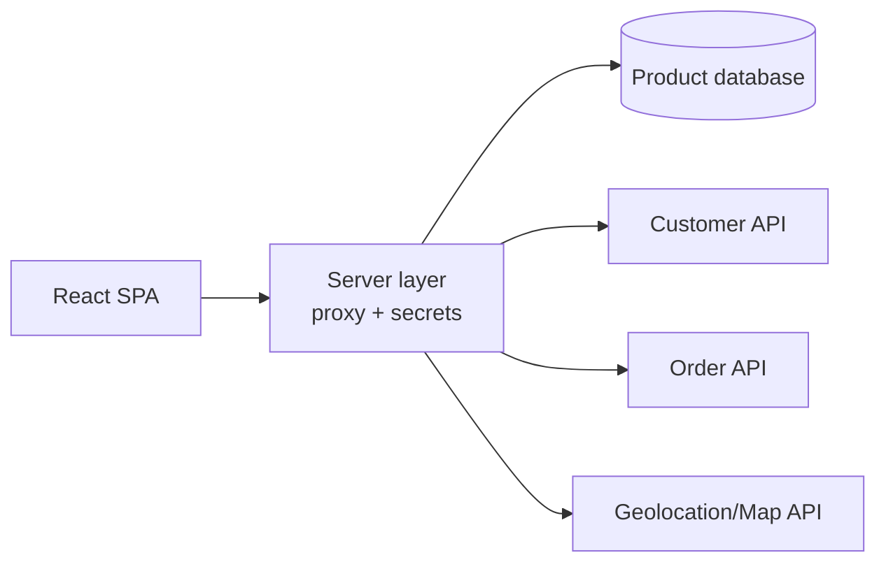

<!--

LAYOUT
- H1 is the title of the system
- H2 is the section title
- H3-H6+ is the subsection title
- system description paragraph
- sections and subsections are expressed as headings (##, ###, etc.)
- sections and subsections are not required to be in any particular order, but are recommended to follow the defined order, which is from conceptual to concrete
- custom sections and subsections are allowed
- sections can have a default subsection, which is the content under the section heading without a subsection heading
- when a section has other subsections defined, it is preferred to have the default subsection explicitly provide its subsection heading
- users may choose to omit subsections and instead put all content in the default subsection. For example: in Requirements, all requirements can be expressed in the default subsection without having to create a Functional or Non-Functional subsection.
- this file, including common sections and subsections, can span multiple files

ASSETS
- any image, video, or other media asset can be referenced in the spec
- MCP integrations to access assets from Figma, Miro, or other tools are supported

IDENTIFIERS
- any list item or paragraph can specify an identifier as a prefix like: **ID-1**
- any section or subsection can specify an identifier as a prefix like: ID-2: Section Title (no asterisks)
- in other sections of the document, reference identifiers with parentheses like: (ID-1)
  - example: "See (ID-1) for the requirement that all external API calls must be proxied through the server layer."
- as a fallback, can reference items by breadcrumb path like: (Requirements > Non-Functional > Security > 1)

TAGS
- any list item or paragraph can specify a tag as a prefix like: [tag]
- tags should appear after identifiers, if both are present, and be separated by a space like: **ID-1** [tag]
- supported tags:
  - priority tags: [low], [medium], [high], [critical]
  - issue status tags: [open], [fixed], [deferred], [wont-fix]

LISTS
- short lists expressed as a comma delimited, single line: item1, item2, item3
- long lists expressed as a multi-line, bulleted or numbered list
- lists with comprehensive content can be broken into subsections
- lists can be expressed as tables, if the content is tabular in nature
- lists can be nested to any depth, but should be kept to a reasonable level of complexity

SECTIONS
- Features: Describe the system capabilities and what it does for its users.
- Requirements: Describe the functional and non-functional requirements of the system.
  - Functional
  - Non-Functional (note: subsections within can also exist adjacent to this subsection)
    - Performance
    - Reliability
    - Accessibility
    - Security
    - Regulatory
  - Technical
  - Out of Scope: Describe what is explicitly not included in the system.
  - Future (alias: Planned): Describe what is planned for future releases of the system.
- Verification: Describe how the system will be verified and validated, including testing strategies and acceptance criteria. (use in rigid requirements scenario)
- Considerations: Describe the assumptions, constraints, and other factors that affect the design and implementation of the system.
  - Assumptions: Describe the assumptions made about the system and its environment.
  - Constraints: Describe the limitations and restrictions that affect the system design and implementation.
  - Dependencies: Describe the external systems and services that the system depends on.
  - Risks: Describe the potential risks and issues that may arise during the development and operation of the system.
- User Stories
  - Personas (alias: Actors)
  - Stories (alias: Contents, Entries)
  - User Flow (alias: Flow)
  - Acceptance Criteria (alias: Acceptance)
- Architecture
- Domain
  - Entities (alias: Objects)
  - Relationships (alias: Associations)
  - Types (alias: Data Types)
- External Interfaces: Describes the external systems and services that the system interacts with, including APIs, protocols, and data formats. All subsections are custom and can be named according to the external system or service being described.
- Functionality: Describes the system functionality from an engineering point of view. This is implementation guidance for all elements of the system not covered by UI or API.
  - Events
  - Triggers
  - Actions
  - Data Flows
  - Jobs
  - Messaging
  - Functions (alias: Lambdas)
  - Workers
- Folder Structure
- UI (note: many of these subsections overlap intentionally)
  - Layout
  - Pages
  - Screens
  - Windows
  - Views
  - Components
  - Navigation
  - Styles
  - Themes
  - Events | Interactions
  - Animations
  - Accessibility
  - Assets
- API: Describes the API the system exposes (note: APIs consumed go in External Interfaces), including endpoints, request/response formats, and authentication methods.
- Database: Describes any physical or logical databases used by the system. Compliments Domain, which describes the logical data model, but does not describe the physical implementation of the database.
  - Tables
  - Columns
  - Indexes
  - Relationships
  - Constraints
  - Views
  - Stored Procedures
  - Triggers
- Testing: Describes the testing strategy and approach for the system, including test types, test cases, and test data.
  - Unit
  - Integration
  - E2E
  - Performance (alias: Load)
  - Security (alias: Penetration)
  - Accessibility
- Setup: Describes the steps required to set up the system for development, testing, and production environments.
  - Prerequisites
  - Installation (alias: Getting Started)
  - Configuration
  - Validation
- Deployment: Describes the steps and procedures required to deploy the system, including any necessary configuration and environment variables.
  - Environments
  - CI/CD (alias: Pipeline)
  - Infrastructure (alias: IaC)
  - Targets (alias: Hosting)
  - Configuration (alias: Environment Variables)
  - Secrets
- Issues: captures ongoing issues, bugs, and feature requests for the system. (when issue status subsections are used, then issue status tags should not be used)
  - Open
  - Fixed
  - Deferred
  - Won't Fix
- Glossary
- References

REQUIREMENTS
- each requirement can have nested list of scenarios
- each requirement or scenario can have nested list of acceptance criteria/verification steps
- requirements and scenarios should be expressed with RFC 2119 keywords: must, must not, should, should not, may, recommended, optional; or alternatively using EARS notation
- a requirement should express a single capability, example: "The system MUST allow users to create an account."
- a requirement should avoid compound statements like: "The system MUST allow users to create an account and view their order history."
- scenarios will typically follow the format: "Given [context], when [event], then [outcome]."
- by default, key verbs should use natural casing "A system shall..." vs UPPER CASE "A system SHALL..."
- when using scenario mode, all requirements are expressed as scenarios, and the requirement itself is a summary of the scenario(s) it contains
- when using Gherkin format, scenarios are formatted as bullets for each requirement:
  Example:
  Successful registration with valid details
  - Given the user is on the registration page
  - When the user enters a valid username, email, and password
  - And the user clicks the register button
  - Then the user should be redirected to the welcome page
  - And the user should see a registration confirmation message

OPTIONS (configurable settings when generating or reformatting the spec)
- all sections:
  - include: true | false (default true, but depends on section) - Whether to include the section in the output
  - granularity: 1-5 (default 3, but depends on section) - Level of detail to include in the section, where 1 is high-level and 5 is very detailed
  - include_subsections: list of subsection names that must be included, or empty list to include defaults (default empty)
  - exclude_subsections: list of subsection names that must be excluded, or empty list to exclude defaults (default empty)
- requirements:
  - style: "capability" | "scenario" (default "capability")
  - format: "RFC 2119" | "EARS" | "gherkin" | "natural" (default "RFC 2119")
  - key_verbs_casing: "natural" | "upper" (default "natural")
  - use_ids: true | false (default true)
  - flatten_non_functional: true | false (default false)
- verification:
  - include: true when inline is false
  - inline: true | false (default true) - Whether inline with requirements or in a separate section
  - style: "acceptance" | "test" (default "acceptance")

DEFINITIONS
- granularity: The level of detail to include in a section, typically following this pattern:
  - 1: high-level description, basic summary, usually as a paragraph
  - 2: General details as bulleted list
  - 3: Standard level of detail, several bulleted items (default)
  - 4: Detailed description, many specifics; can be multiple paragraphs or lists, nested lists, expanded subsections
  - 5: Very detailed, exhaustive description; about as detailed as possible, describing every aspect of the system, including edge cases, error handling, and implementation details


-->
---
id: web-store-frontend
title: Web Store Frontend
version: "1"
status: draft
type: web
tech:
  languages: TypeScript
  frameworks: React v19+, Express
  platform: browser, Node.js
metadata:
  created: 2026-08-05
---

# Web Store Frontend

A storefront web application for browsing and purchasing products online. The product catalog and search are served directly by this component; customer accounts, order processing, and location-based features (store lookup, delivery estimates) come from external backend services this component depends on. A thin server-side layer holds the API credentials for those services and proxies browser requests to them, so secrets never reach the client.

## Features

- Browse and search a catalog of products by name and category.
- View product details (price, description, image, category).
- Create an account, sign in, and view order history.
- Complete checkout and place an order.
- Look up nearby stores or estimate delivery using location-based search.

## Requirements

### Functional

- **F-01**: Visitors must be able to browse products, filter by category, and search by keyword.
  - Scenario: TBD
- **F-02**: Visitors must be able to view a single product's full details.
- **F-03**: Users must be able to create an account and view their past orders.
- **F-04**: Users must be able to complete checkout, resulting in an order created via the external Order API.
- **F-05**: [high] All calls to external services (Customer, Order, Geolocation) must be proxied through this component's own server layer -- API keys are never sent to or exposed in the browser.
- **F-06**: Users must be able to search for nearby stores or get a delivery estimate using the Geolocation/Map API.

### Non-Functional

#### Performance
- [high] Product search and category filtering must return results within 500ms for a catalog of up to 10,000 products.

#### Reliability
- If an external service (Customer, Order, or Geolocation API) is unavailable, the proxy must return a clear error to the client rather than hanging or leaking a raw upstream error.

#### Accessibility
- [high] Product browsing, search, and checkout must be operable via keyboard alone.

### Technical

- The product catalog is owned and served by this component's own database; customer and order data are owned by external services (see External Interfaces).
- All secret API keys are held server-side only and never sent to the browser.

### Security
- [high] All external API calls must be proxied through the server layer to prevent exposing API keys in the client.

### Regulatory
- The component must comply with GDPR and CCPA for handling customer data, including the ability to delete a customer's account and associated data upon request.

### Out of Scope

- Payment processing details (assumed handled by the external Order API).
- Multi-currency and internationalization.
- Seller/admin tooling for managing the product catalog.

### Future

- Product recommendations and recently-viewed history.
- Wishlist/saved-items support.

## Considerations

- Product data is owned locally; customer and order data are owned by external systems this component doesn't control -- the correctness and availability of those flows depend on those services.

### Assumptions

- A lightweight Node/Express server layer is assumed for the proxy, since none was specified -- any server runtime capable of holding secrets and forwarding HTTP requests satisfies this requirement.
- Each product has exactly one category; multi-category tagging is not supported in this phase.

### Constraints

### Dependencies

-


## User Stories

### Personas

- **Shopper**: browses and purchases products; may or may not have an account.
- **Account Holder**: a signed-in Shopper who can view order history.

### Stories

- As a [Shopper], I want to browse products by category so I can find what I'm looking for.
- As a [Shopper], I want to search products by keyword so I can find a specific item quickly.
- As an [Account Holder], I want to view my past orders so I can track what I've purchased.
  - [ ] Order history is fetched from the external Order API via the proxy, not stored locally.
- As a [Shopper], I want to find a nearby store or see a delivery estimate so I can decide how to receive my order.

### Acceptance Criteria

- [ ] No API key or credential for an external service is ever visible in browser network requests or client-side code.
- [ ] Product search returns results without a full page reload.

## Architecture

A React single-page application backed by a thin Node/Express server layer. The browser never calls the external Customer, Order, or Geolocation APIs directly -- it calls this component's own proxy endpoints (see API), which attach server-held credentials and forward the request. The product catalog is the exception: it's owned directly by this component's own database and served without proxying to an external system.



## Domain

### Entities

#### Product
- id: `uuid`
- name: `string` (required, max 200 chars)
- description: `string?`
- price: `float` (required, >= 0)
- category: `CategoryName` (required)
- imageUrl: `string?`
- stock: `int` (default: 0)

#### Customer
- id: `uuid`
- name: `string` (required)
- email: `Email` (required)
- createdAt: `datetime`

#### Order
- id: `uuid`
- customerId: `uuid` (ref: Customer.id)
- items: `[OrderLine]` (required, min 1)
- status: `OrderStatus`
- total: `float`
- createdAt: `datetime`

### Relationships

- A Customer has many Orders (one-to-many).
- An Order contains one or more OrderLines; each OrderLine references one Product.

### Types

- CategoryName: `string` -- open-ended, defined by catalog content (e.g. "Electronics", "Home", "Apparel").
- Email: `string` (must contain '@', max 254 chars)
- OrderStatus: `"pending" | "paid" | "shipped" | "delivered" | "cancelled"`
- OrderLine:
    productId: `uuid`
    quantity: `int`
    unitPrice: `float`

<!--
  This component has BOTH an owned ## API (the proxy endpoints and the
  locally-owned product catalog) and a populated ## External Interfaces
  (the Customer, Order, and Geolocation services it depends on) -- the
  two sections aren't mutually exclusive. Own what you build, list what
  you merely consume; a component can do both at once.
-->

## External Interfaces

### Customer API
REST. Owns customer accounts and authentication. This component proxies to it for account creation, sign-in, and profile lookups -- see [Customer API Open API Spec](/path/to/customer-api.json).

### Order API
REST. Owns order creation and order history. This component proxies to it at checkout and when a signed-in customer views past orders.

### Geolocation/Map API
Third-party mapping/geocoding provider. Used for store-locator search and delivery estimates. Proxied the same way as Customer and Order to keep the provider's API key server-side.

## UI

### Layout
Header with logo, category navigation, and search bar; main content area for the product grid, product detail, or account page; footer with site links.

### Pages
- **Home / Product Grid**: Default route. Product grid with category and search filtering.
- **Product Detail**: A single product's full details and an add-to-cart/checkout action.
- **Account**: Signed-in customer's profile and order history.

### Components
- **ProductGrid**: Responsive grid of product cards.
- **ProductCard**: Compact product summary (image, name, price) linking to Product Detail.
- **CategoryNav**: Category filter navigation.
- **SearchBar**: Debounced keyword search input.
- **OrderHistoryList**: List of past orders on the Account page.
- **StoreLocator**: Map/list of nearby stores using the Geolocation/Map API.

### Accessibility
WCAG 2.1 AA as the target level. All interactive elements keyboard-operable; product images require descriptive alt text.

### Theme

A bland, neutral corporate palette -- shades of blue and gray -- intended to keep attention on product photography rather than the UI itself. No bright accent colors.

#### Colors
- Primary (links, buttons): `#3B5A82` (mid blue)
- Secondary (accents, hover states): `#6E8299` (blue-gray)
- Background: `#F4F5F7` (light gray)
- Text: `#2A2E33` (near-black gray)
- Borders/dividers: `#D3D7DC` (light gray)

#### Typography
Neutral system sans-serif stack; no display/decorative typeface.

## API

### Proxy Endpoints
- `GET /api/customers/{id}`: Proxies to the external Customer API, attaching the server-held API key.
- `POST /api/orders`: Proxies to the external Order API to create an order at checkout.
- `GET /api/orders?customerId={id}`: Proxies to the external Order API for a customer's order history.
- `GET /api/geocode`: Proxies to the external Geolocation/Map API for store-locator and delivery-estimate lookups.


## Testing

### Unit
Proxy request/response handling (credential attachment, error normalization) and product catalog query logic are unit tested.

### Integration
A Docker container running a stand-in backend (mocked Customer, Order, and Geolocation APIs) plus a seeded product database with known test data is spun up for integration tests, verifying the proxy layer and product endpoints end-to-end without depending on the real external services.

## Folder Structure

```
src/
+-- client/             # React SPA
|   +-- components/      # ProductGrid, ProductCard, CategoryNav, SearchBar, ...
|   +-- pages/            # HomePage, ProductDetailPage, AccountPage
+-- server/             # Express proxy layer
|   +-- routes/           # /api/products, /api/customers, /api/orders, /api/geocode
|   +-- db/               # Product database access
+-- types/              # Product, Customer, Order, and related domain types
```

## Setup

### Prerequisites
- Node.js LTS.
- Docker, for running integration tests locally.

### Validation
- `npm run dev` and confirm the product grid loads from the local database.

## Deployment

Deploys to Kubernetes on an unspecified cloud provider, as a set of containers (the server/proxy process, serving the client build) behind a standard Ingress/Service.

### Configuration

- `CUSTOMER_API_KEY`: `<set in cluster secret>`
- `ORDER_API_KEY`: `<set in cluster secret>`
- `GEO_API_KEY`: `<set in cluster secret>`
- `DATABASE_URL`: `<see vault>`

## Issues

- [open] The Geolocation/Map API has an undocumented rate limit; heavy store-locator usage during peak traffic could start failing silently.
- [open] Product images are served directly from the product database's storage with no CDN in front of them yet, which may affect page load performance at scale.
- [open] There's no webhook from the Order API for status changes (e.g. shipped, delivered) -- the Account page's order status is only as fresh as the last time it was fetched.

## References

### Design
- Figma: [Storefront Wireframes](https://figma.com/file/storefront-wireframes) -- accessible via the Figma MCP server; fetch current wireframes through that connector when implementing UI rather than treating this link as a static snapshot.
