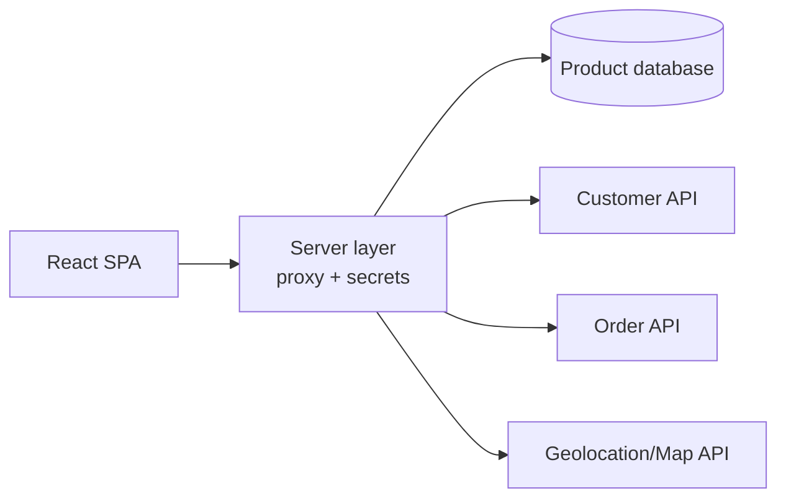

<!--
  Structure follows ISO/IEC/IEEE 29148's SRS outline (Introduction / Overall
  Description / Specific Requirements / Verification / Appendices), not the
  specmd section catalog in spec.yml -- this is a different `schema` entirely
  (see frontmatter), so specmd's section rules (Contents Pattern, priority
  tag placement, etc.) don't apply here except where explicitly reused below.
  This file was produced directly
  from the ISO/IEC/IEEE 29148 outline per that guidance.
  Same underlying product as spec-detailed.md (a storefront web app) --
  compare the two side by side to see how the same intent reads in each
  format's idiom.
-->
---
id: web-store-frontend-srd
title: Web Store Frontend
version: "1"
status: draft
type: web
schema: srd
tech:
  languages: TypeScript
  frameworks: React v19+, Express
  platform: browser, Node.js
metadata:
  created: 2026-08-05
---

# Web Store Frontend

Software Requirements Specification, per ISO/IEC/IEEE 29148.

## 1. Introduction

### 1.1 Purpose

This document specifies the requirements for the Web Store Frontend, a storefront web application for browsing and purchasing products online. It is intended for the engineering team implementing the system and for reviewers validating that the implementation matches intent.

### 1.2 Scope

The system serves a product catalog and search directly. Customer accounts, order processing, and location-based features (store lookup, delivery estimates) are provided by external backend services this system depends on and proxies to, rather than owning. A thin server-side layer holds the credentials for those services so secrets never reach the client.

**In scope**: product browsing/search, product detail views, account creation and sign-in, order history display, checkout, and store/delivery lookup via proxied external services.

**Out of scope**:
- Payment processing details (assumed handled by the external Order API).
- Multi-currency and internationalization.
- Seller/admin tooling for managing the product catalog.

Deferred to a later release (see Appendix C): product recommendations and recently-viewed history, wishlist/saved-items support.

### 1.3 Definitions, Acronyms, and Abbreviations

- **SPA**: Single-Page Application.
- **REST**: Representational State Transfer.
- **WCAG**: Web Content Accessibility Guidelines.
- **Proxy layer**: the server-side component that forwards browser requests to external APIs while attaching credentials.

### 1.4 References

- Figma: [Storefront Wireframes](https://figma.com/file/storefront-wireframes) -- accessible via the Figma MCP server; fetch current wireframes through that connector when implementing UI rather than treating this link as a static snapshot.

### 1.5 Document Overview

Section 2 describes the system at a high level: perspective, functions, users, constraints, and assumptions. Section 3 states specific, testable requirements. Section 4 defines how those requirements are verified. Section 5 holds supplementary material (user stories, deployment detail, and known issues) that supports but isn't itself a formal requirement.

Requirement priority is annotated inline using `[critical]` / `[high]` / `[normal]` / `[low]`; a requirement with no tag is `[normal]`.

## 2. Overall Description

### 2.1 Product Perspective

The system is a React single-page application backed by a thin Node/Express server layer. The browser never calls the external Customer, Order, or Geolocation APIs directly -- it calls this system's own proxy endpoints (see 3.1.3), which attach server-held credentials and forward the request. The product catalog is the exception: it's owned directly by this system's own database and served without proxying to an external system.



### 2.2 Product Functions

- Browse and search a catalog of products by name and category.
- View product details (price, description, image, category).
- Create an account, sign in, and view order history.
- Complete checkout and place an order.
- Look up nearby stores or estimate delivery using location-based search.

### 2.3 User Characteristics

- **Shopper**: browses and purchases products; may or may not have an account.
- **Account Holder**: a signed-in Shopper who can view order history.

### 2.4 Constraints

- Product data is owned locally; customer and order data are owned by external systems this system doesn't control -- the correctness and availability of those flows depend on those services.
- All secret API keys must be held server-side only and must never reach the browser (elaborated as DC-01/DC-02 in 3.4).

### 2.5 Assumptions and Dependencies

- A lightweight Node/Express server layer is assumed for the proxy, since none was specified -- any server runtime capable of holding secrets and forwarding HTTP requests satisfies this requirement.
- Each product has exactly one category; multi-category tagging is not supported in this phase.
- Depends on the continued availability and API stability of the external Customer, Order, and Geolocation/Map services (see 3.1.3).

## 3. Specific Requirements

### 3.1 External Interface Requirements

#### 3.1.1 User Interfaces

**Layout**: header with logo, category navigation, and search bar; main content area for the product grid, product detail, or account page; footer with site links.

**Pages**:
- **Home / Product Grid**: default route. Product grid with category and search filtering.
- **Product Detail**: a single product's full details and an add-to-cart/checkout action.
- **Account**: signed-in customer's profile and order history.

**Components**:
- **ProductGrid**: responsive grid of product cards.
- **ProductCard**: compact product summary (image, name, price) linking to Product Detail.
- **CategoryNav**: category filter navigation.
- **SearchBar**: debounced keyword search input.
- **OrderHistoryList**: list of past orders on the Account page.
- **StoreLocator**: map/list of nearby stores using the Geolocation/Map API.

**Theme**: a bland, neutral corporate palette -- shades of blue and gray -- intended to keep attention on product photography rather than the UI itself. No bright accent colors.

| Role | Color |
|---|---|
| Primary (links, buttons) | `#3B5A82` (mid blue) |
| Secondary (accents, hover states) | `#6E8299` (blue-gray) |
| Background | `#F4F5F7` (light gray) |
| Text | `#2A2E33` (near-black gray) |
| Borders/dividers | `#D3D7DC` (light gray) |

Typography: neutral system sans-serif stack; no display/decorative typeface.

#### 3.1.2 Hardware Interfaces

Not applicable -- the system has no direct hardware interface.

#### 3.1.3 Software Interfaces

**Consumed (external, not owned by this system)**:
- **Customer API** -- REST. Owns customer accounts and authentication. Proxied for account creation, sign-in, and profile lookups.
- **Order API** -- REST. Owns order creation and order history. Proxied at checkout and when a signed-in customer views past orders.
- **Geolocation/Map API** -- third-party mapping/geocoding provider. Used for store-locator search and delivery estimates; proxied the same way as Customer and Order to keep the provider's API key server-side.

**Provided (owned by this system)**:
- `GET /api/customers/{id}`: proxies to the external Customer API, attaching the server-held API key.
- `POST /api/orders`: proxies to the external Order API to create an order at checkout.
- `GET /api/orders?customerId={id}`: proxies to the external Order API for a customer's order history.
- `GET /api/geocode`: proxies to the external Geolocation/Map API for store-locator and delivery-estimate lookups.
- `GET /api/products`: lists products from this system's own database; supports category and search-keyword query params.
- `GET /api/products/{id}`: returns a single product by id.

**Error handling**: errors from the above are defined jointly with REL-01 (3.3) -- an unavailable upstream must not surface as a hang or a leaked raw upstream error.

#### 3.1.4 Communications Interfaces

All client-server and server-to-external-service communication is REST over HTTPS.

### 3.2 Functional Requirements

- **FR-01** `[high]` All calls to external services (Customer, Order, Geolocation) shall be proxied through this system's own server layer -- API keys shall never be sent to or exposed in the browser.
- **FR-02** Visitors shall be able to browse products, filter by category, and search by keyword.
- **FR-03** Visitors shall be able to view a single product's full details.
- **FR-04** Users shall be able to create an account and view their past order history, fetched from the external Order API via the proxy rather than stored locally.
- **FR-05** Users shall be able to complete checkout, resulting in an order created via the external Order API.
- **FR-06** Users shall be able to search for nearby stores or obtain a delivery estimate using the Geolocation/Map API.

### 3.3 Performance Requirements

- **PERF-01** `[high]` Product search and category filtering shall return results within 500ms for a catalog of up to 10,000 products.
- **PERF-02** Product search shall return results without a full page reload.

### 3.4 Design Constraints

- **DC-01** The product catalog shall be owned and served by this system's own database; customer and order data shall be owned by external services (see 3.1.3).
- **DC-02** `[critical]` All secret API keys shall be held server-side only and shall never be sent to the browser. No API key or credential for an external service shall ever be visible in browser network requests or client-side code.

### 3.5 Software System Attributes

#### 3.5.1 Reliability

- **REL-01** If an external service (Customer, Order, or Geolocation API) is unavailable, the proxy shall return a clear error to the client rather than hanging or leaking a raw upstream error.

#### 3.5.2 Security

- **SEC-01** See DC-02 -- credential isolation is the system's primary security requirement.

#### 3.5.3 Usability / Accessibility

- **A11Y-01** `[high]` Product browsing, search, and checkout shall be operable via keyboard alone.
- Target conformance level: WCAG 2.1 AA. All interactive elements keyboard-operable; product images require descriptive alt text.

#### 3.5.4 Portability

- The client targets evergreen browsers; the server layer targets Node.js. No OS-specific dependencies are assumed.

### 3.6 Data Requirements

#### 3.6.1 Entities

**Product**
- id: `uuid`
- name: `string` (required, max 200 chars)
- description: `string?`
- price: `float` (required, >= 0)
- category: `CategoryName` (required)
- imageUrl: `string?`
- stock: `int` (default: 0)

**Customer**
- id: `uuid`
- name: `string` (required)
- email: `Email` (required)
- createdAt: `datetime`

**Order**
- id: `uuid`
- customerId: `uuid` (ref: Customer.id)
- items: `[OrderLine]` (required, min 1)
- status: `OrderStatus`
- total: `float`
- createdAt: `datetime`

#### 3.6.2 Relationships

- A Customer has many Orders (one-to-many).
- An Order contains one or more OrderLines; each OrderLine references one Product.

#### 3.6.3 Types

- CategoryName: `string` -- open-ended, defined by catalog content (e.g. "Electronics", "Home", "Apparel").
- Email: `string` (must contain '@', max 254 chars)
- OrderStatus: `"pending" | "paid" | "shipped" | "delivered" | "cancelled"`
- OrderLine:
    productId: `uuid`
    quantity: `int`
    unitPrice: `float`

## 4. Verification

### 4.1 Verification Methods

| Requirement(s) | Method |
|---|---|
| FR-02, FR-03, FR-06 | Test (unit + integration) |
| FR-01, DC-02, SEC-01 | Test + inspection (no credential ever present in a browser-observable request or bundle) |
| FR-04, FR-05 | Integration test against the proxy layer |
| PERF-01 | Test (load/benchmark against a 10,000-product catalog) |
| REL-01 | Integration test (simulated upstream failure) |
| A11Y-01 | Test (keyboard-only walkthrough of browse/search/checkout) |

**Unit**: proxy request/response handling (credential attachment, error normalization) and product catalog query logic are unit tested.

**Integration**: a Docker container running a stand-in backend (mocked Customer, Order, and Geolocation APIs) plus a seeded product database with known test data is spun up for integration tests, verifying the proxy layer and product endpoints end-to-end without depending on the real external services.

### 4.2 Acceptance Criteria

- [ ] No API key or credential for an external service is ever visible in browser network requests or client-side code.
- [ ] Product search returns results without a full page reload.
- [ ] Order history is fetched from the external Order API via the proxy, not stored locally.

### 4.3 Setup Validation

Run `npm run dev` and confirm the product grid loads from the local database.

Prerequisites: Node.js LTS; Docker, for running integration tests locally.

## 5. Appendices

### Appendix A: User Stories

Supplementary narrative context for FR-01 through FR-06 above; not itself a source of new requirements.

- As a **Shopper**, I want to browse products by category so I can find what I'm looking for. (FR-02)
- As a **Shopper**, I want to search products by keyword so I can find a specific item quickly. (FR-02)
- As an **Account Holder**, I want to view my past orders so I can track what I've purchased. (FR-04)
- As a **Shopper**, I want to find a nearby store or see a delivery estimate so I can decide how to receive my order. (FR-06)

### Appendix B: Deployment and Operations

Deploys to Kubernetes on an unspecified cloud provider, as a set of containers (the server/proxy process, serving the client build) behind a standard Ingress/Service.

**Configuration** (names only -- see Secrets Policy; no values recorded here):
- `CUSTOMER_API_KEY`: `<set in cluster secret>`
- `ORDER_API_KEY`: `<set in cluster secret>`
- `GEO_API_KEY`: `<set in cluster secret>`
- `DATABASE_URL`: `<see vault>`

**Folder structure**:
```
src/
+-- client/             # React SPA
|   +-- components/      # ProductGrid, ProductCard, CategoryNav, SearchBar, ...
|   +-- pages/            # HomePage, ProductDetailPage, AccountPage
+-- server/             # Express proxy layer
|   +-- routes/           # /api/products, /api/customers, /api/orders, /api/geocode
|   +-- db/               # Product database access
+-- types/              # Product, Customer, Order, and related domain types
```

### Appendix C: Open Issues and Risks

- The Geolocation/Map API has an undocumented rate limit; heavy store-locator usage during peak traffic could start failing silently.
- Product images are served directly from the product database's storage with no CDN in front of them yet, which may affect page load performance at scale.
- There's no webhook from the Order API for status changes (e.g. shipped, delivered) -- the Account page's order status is only as fresh as the last time it was fetched.

### Appendix D: Future Enhancements

Not part of this release; noted for planning purposes only.

- Product recommendations and recently-viewed history.
- Wishlist/saved-items support.
