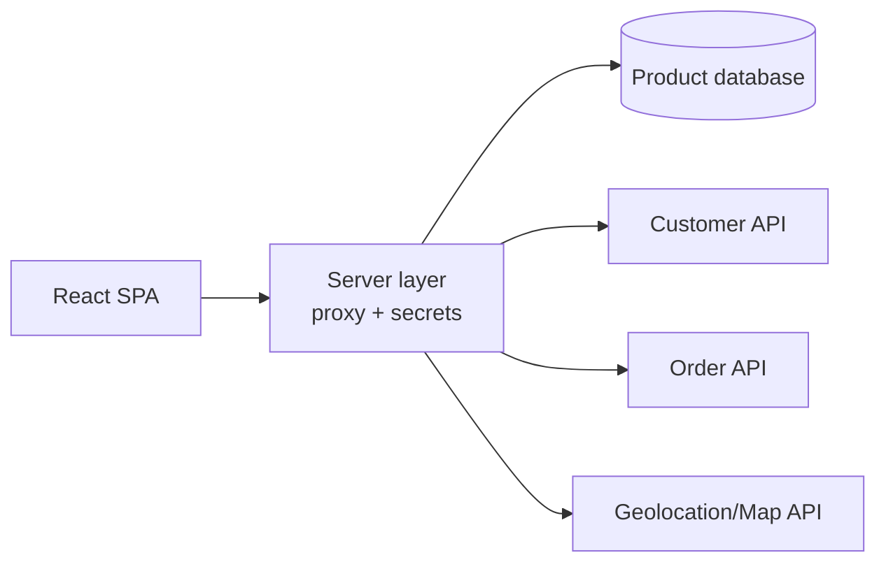

<!--
  Detailed spec template -- a fully fleshed-out SPEC.md, kept as a second
  source of truth alongside the prose rules in schema-specmd.yaml and
  core.yml. Where the schema files define each section in isolation, this
  file shows how they fit together in one coherent document: canonical
  section order, the Domain Entities/Relationships/Types split, the
  External Interfaces vs. API boundary (including a case where a
  component legitimately has both), and other structural conventions
  that are easier to see than to describe.
  This is a reference for the Define function to consult, not a fixed
  shape to fill in like a form -- omit sections that don't apply, and
  never carry this file's example content (Product, Customer, Order,
  etc.) into an unrelated spec.
-->
---
id: web-store-frontend
title: Web Store Frontend
version: "1"
status: draft
type: web
tech:
  languages: TypeScript
  frameworks: React v19+, Express
  platform: browser, Node.js
metadata:
  created: 2026-08-05
---

# Web Store Frontend

A storefront web application for browsing and purchasing products online. The product catalog and search are served directly by this component; customer accounts, order processing, and location-based features (store lookup, delivery estimates) come from external backend services this component depends on. A thin server-side layer holds the API credentials for those services and proxies browser requests to them, so secrets never reach the client.

## Features

- Browse and search a catalog of products by name and category.
- View product details (price, description, image, category).
- Create an account, sign in, and view order history.
- Complete checkout and place an order.
- Look up nearby stores or estimate delivery using location-based search.

## Requirements

### Functional

- Visitors must be able to browse products, filter by category, and search by keyword.
- Visitors must be able to view a single product's full details.
- Users must be able to create an account and view their past orders.
- Users must be able to complete checkout, resulting in an order created via the external Order API.
- [high] All calls to external services (Customer, Order, Geolocation) must be proxied through this component's own server layer -- API keys are never sent to or exposed in the browser.
- Users must be able to search for nearby stores or get a delivery estimate using the Geolocation/Map API.

### Non-Functional

#### Performance
- [high] Product search and category filtering must return results within 500ms for a catalog of up to 10,000 products.

#### Reliability
- If an external service (Customer, Order, or Geolocation API) is unavailable, the proxy must return a clear error to the client rather than hanging or leaking a raw upstream error.

#### Accessibility
- [high] Product browsing, search, and checkout must be operable via keyboard alone.

### Technical

- The product catalog is owned and served by this component's own database; customer and order data are owned by external services (see External Interfaces).
- All secret API keys are held server-side only and never sent to the browser.

### Out of Scope

- Payment processing details (assumed handled by the external Order API).
- Multi-currency and internationalization.
- Seller/admin tooling for managing the product catalog.

### Future

- Product recommendations and recently-viewed history.
- Wishlist/saved-items support.

## Considerations

- Product data is owned locally; customer and order data are owned by external systems this component doesn't control -- the correctness and availability of those flows depend on those services.

### Assumptions

- A lightweight Node/Express server layer is assumed for the proxy, since none was specified -- any server runtime capable of holding secrets and forwarding HTTP requests satisfies this requirement.
- Each product has exactly one category; multi-category tagging is not supported in this phase.

## User Stories

### Personas

- **Shopper**: browses and purchases products; may or may not have an account.
- **Account Holder**: a signed-in Shopper who can view order history.

### Stories

- As a [Shopper], I want to browse products by category so I can find what I'm looking for.
- As a [Shopper], I want to search products by keyword so I can find a specific item quickly.
- As an [Account Holder], I want to view my past orders so I can track what I've purchased.
  - [ ] Order history is fetched from the external Order API via the proxy, not stored locally.
- As a [Shopper], I want to find a nearby store or see a delivery estimate so I can decide how to receive my order.

### Acceptance Criteria

- [ ] No API key or credential for an external service is ever visible in browser network requests or client-side code.
- [ ] Product search returns results without a full page reload.

## Architecture

A React single-page application backed by a thin Node/Express server layer. The browser never calls the external Customer, Order, or Geolocation APIs directly -- it calls this component's own proxy endpoints (see API), which attach server-held credentials and forward the request. The product catalog is the exception: it's owned directly by this component's own database and served without proxying to an external system.



## Domain

### Entities

#### Product
- id: `uuid`
- name: `string` (required, max 200 chars)
- description: `string?`
- price: `float` (required, >= 0)
- category: `CategoryName` (required)
- imageUrl: `string?`
- stock: `int` (default: 0)

#### Customer
- id: `uuid`
- name: `string` (required)
- email: `Email` (required)
- createdAt: `datetime`

#### Order
- id: `uuid`
- customerId: `uuid` (ref: Customer.id)
- items: `[OrderLine]` (required, min 1)
- status: `OrderStatus`
- total: `float`
- createdAt: `datetime`

### Relationships

- A Customer has many Orders (one-to-many).
- An Order contains one or more OrderLines; each OrderLine references one Product.

### Types

- CategoryName: `string` -- open-ended, defined by catalog content (e.g. "Electronics", "Home", "Apparel").
- Email: `string` (must contain '@', max 254 chars)
- OrderStatus: `"pending" | "paid" | "shipped" | "delivered" | "cancelled"`
- OrderLine:
    productId: `uuid`
    quantity: `int`
    unitPrice: `float`

<!--
  This component has BOTH an owned ## API (the proxy endpoints and the
  locally-owned product catalog) and a populated ## External Interfaces
  (the Customer, Order, and Geolocation services it depends on) -- the
  two sections aren't mutually exclusive. Own what you build, list what
  you merely consume; a component can do both at once.
-->

## External Interfaces

### Customer API
REST. Owns customer accounts and authentication. This component proxies to it for account creation, sign-in, and profile lookups -- see API.

### Order API
REST. Owns order creation and order history. This component proxies to it at checkout and when a signed-in customer views past orders.

### Geolocation/Map API
Third-party mapping/geocoding provider. Used for store-locator search and delivery estimates. Proxied the same way as Customer and Order to keep the provider's API key server-side.

## UI

### Layout
Header with logo, category navigation, and search bar; main content area for the product grid, product detail, or account page; footer with site links.

### Pages
- **Home / Product Grid**: Default route. Product grid with category and search filtering.
- **Product Detail**: A single product's full details and an add-to-cart/checkout action.
- **Account**: Signed-in customer's profile and order history.

### Components
- **ProductGrid**: Responsive grid of product cards.
- **ProductCard**: Compact product summary (image, name, price) linking to Product Detail.
- **CategoryNav**: Category filter navigation.
- **SearchBar**: Debounced keyword search input.
- **OrderHistoryList**: List of past orders on the Account page.
- **StoreLocator**: Map/list of nearby stores using the Geolocation/Map API.

### Accessibility
WCAG 2.1 AA as the target level. All interactive elements keyboard-operable; product images require descriptive alt text.

### Theme

A bland, neutral corporate palette -- shades of blue and gray -- intended to keep attention on product photography rather than the UI itself. No bright accent colors.

#### Colors
- Primary (links, buttons): `#3B5A82` (mid blue)
- Secondary (accents, hover states): `#6E8299` (blue-gray)
- Background: `#F4F5F7` (light gray)
- Text: `#2A2E33` (near-black gray)
- Borders/dividers: `#D3D7DC` (light gray)

#### Typography
Neutral system sans-serif stack; no display/decorative typeface.

## API

### Proxy Endpoints
- `GET /api/customers/{id}`: Proxies to the external Customer API, attaching the server-held API key.
- `POST /api/orders`: Proxies to the external Order API to create an order at checkout.
- `GET /api/orders?customerId={id}`: Proxies to the external Order API for a customer's order history.
- `GET /api/geocode`: Proxies to the external Geolocation/Map API for store-locator and delivery-estimate lookups.

### Product Endpoints
- `GET /api/products`: Lists products from this component's own database; supports category and search-keyword query params.
- `GET /api/products/{id}`: Returns a single product by id.

## Testing

### Unit
Proxy request/response handling (credential attachment, error normalization) and product catalog query logic are unit tested.

### Integration
A Docker container running a stand-in backend (mocked Customer, Order, and Geolocation APIs) plus a seeded product database with known test data is spun up for integration tests, verifying the proxy layer and product endpoints end-to-end without depending on the real external services.

## Folder Structure

```
src/
+-- client/             # React SPA
|   +-- components/      # ProductGrid, ProductCard, CategoryNav, SearchBar, ...
|   +-- pages/            # HomePage, ProductDetailPage, AccountPage
+-- server/             # Express proxy layer
|   +-- routes/           # /api/products, /api/customers, /api/orders, /api/geocode
|   +-- db/               # Product database access
+-- types/              # Product, Customer, Order, and related domain types
```

## Setup

### Prerequisites
- Node.js LTS.
- Docker, for running integration tests locally.

### Validation
- `npm run dev` and confirm the product grid loads from the local database.

## Deployment

Deploys to Kubernetes on an unspecified cloud provider, as a set of containers (the server/proxy process, serving the client build) behind a standard Ingress/Service.

### Configuration

- `CUSTOMER_API_KEY`: `<set in cluster secret>`
- `ORDER_API_KEY`: `<set in cluster secret>`
- `GEO_API_KEY`: `<set in cluster secret>`
- `DATABASE_URL`: `<see vault>`

## Issues

- [open] The Geolocation/Map API has an undocumented rate limit; heavy store-locator usage during peak traffic could start failing silently.
- [open] Product images are served directly from the product database's storage with no CDN in front of them yet, which may affect page load performance at scale.
- [open] There's no webhook from the Order API for status changes (e.g. shipped, delivered) -- the Account page's order status is only as fresh as the last time it was fetched.

## References

### Design
- Figma: [Storefront Wireframes](https://figma.com/file/storefront-wireframes) -- accessible via the Figma MCP server; fetch current wireframes through that connector when implementing UI rather than treating this link as a static snapshot.
