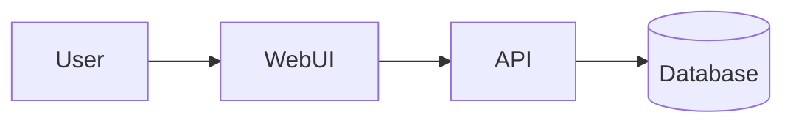

# SPEC.md Format Specification

[current version: 2026-07-28]

A SPEC.md document is structured with a specific format that includes frontmatter, a title, description, and sections. The structure is designed to be flexible and extendible, as a matter of fact, the spec doesn't even need to contain the frontmatter or sections at all.

The SPEC.md structure was purposefully designed to flow from high-level concepts to detailed implementation. This is by design—to aid the agent (and human) in understanding the software system from a general to specific matter to optimize the code generation.

> Browse the [template](template.md) file to preview the format and syntax.

## Starter

The smallest possible SPEC.md file is a single paragraph that describes the intent of the project. This is a great way to get started when specifying a new project. For more information, see the [README  "Getting Started" section](README.md#getting-started).

```markdown
# Filipino Cookbook Website

This is a web application that provides a collection of Filipino recipes. Users can browse, search, view, and vote on recipes. Each recipe page includes ingredients, instructions, images, and some history. Use a modern static website generator to build the site.
```

## Layout

Beyond the starter, a SPEC.md file will be structured with frontmatter and sections. Sections are denoted by H2 headings, and subsections are nested underneath as H3-H6 headings. 

```markdown
---
id: application-name
version: "2"
status: draft
type: web
... other frontmatter fields
---

# Application Title

This is the description of the application. It provides a brief overview of the software system, its purpose, and its functionality. It should be placed immediately after the title and can be one sentence to a few paragraphs. It should be concise and require just enough information for the agent to understand the system's intent.

## Features
...

## Requirements
...

... remaining sections
```

## Lists

Lists anywhere in a spec may be expressed in any of three styles.
Styles may be mixed freely within the same section:

1. Inline comma-delimited:  `languages: TypeScript, Python`
2. Markdown bullet list:    
    ```
    - TypeScript
    - Python
    ```
3. Subsections:
    ```
    ### TypeScript
      description...
    ```

## Frontmatter

The frontmatter contains metadata about the SPEC.md document. It is written in YAML format and is enclosed by triple dashes (`---`) at the beginning and end.

| Field | Required | Type | Description |
|---|---|---|---|
| id | No | string | Unique slug for the spec. If omitted, derived from the H1 title. |
| title | No | string | Canonical title in frontmatter. If omitted, H1 title is used. |
| version | No | string | Spec version in any format (for example `1`, `2.1`, `2025-07-18`). |
| status | No | enum | Lifecycle status: `draft`, `review`, `stable`, or `deprecated`. |
| type | No | enum or string | Spec type: `web`, `mobile`, `desktop`, `api`, `library`, `cli`, `service`, `system`, or `custom`. |
| schema | No | enum or null | Schema identifier for the body. Default is `specmd`; usually omitted. |
| extends-schema | No | list of strings | Extension schema files that add or override sections. |
| tech | No | object | Tech stack metadata container. |
| tech.languages | No | string or list of strings | Primary implementation languages. |
| tech.frameworks | No | string or list of strings | Frameworks and major libraries. |
| tech.platform | No | string | Target runtime or platform (for example browser, Node.js, iOS). |
| tech.dependencies | No | list of strings or DependencyObject | Additional dependencies beyond frameworks. |
| links | No | object | Relationship links to other specs. |
| links.depends-on | No | string, list of strings, LinkObject, or mixed list | Hard dependencies that should be implemented first. |
| links.extends | No | string, list of strings, LinkObject, or mixed list | Specs this spec inherits from or specializes. |
| links.related | No | string, list of strings, LinkObject, or mixed list | Informational spec relationships. |
| instructions | No | string | Agent instructions for handling this spec (for example compacting rules). |
| metadata | No | object | Human metadata container. |
| metadata.author | No | string | Human author or owner. |
| metadata.created | No | string | Creation date in yyyy-mm-dd format. |
| metadata.updated | No | string | Last update date in yyyy-mm-dd format. |
| changelog | No | list of string | Version history entries. |

### Example

```markdown
---
id: simple-crm-frontend
title: Simple CRM Frontend
version: "2"
status: draft
type: web
tech:
  languages:
    - TypeScript
    - HTML
    - CSS
  frameworks:
    - React v19+
    - Vite
    - Tailwind CSS
  platform: browser
  dependencies:
    - React Query v5+
    - Axios
    - React Hook Form
    - MSW (Mock Service Worker) ^2.10.3
meta:
  author: Joe Agster
  updated: 2025-07-16
  changelog:
    - "2025-07-05: Initial version."
    - "2025-07-12: Updated to new Vibespec format."
    - "2025-07-16: Added new features and improved documentation."
---
```

## Sections

Sections are presented as H2 headings. All sections are optional—you may include only the sections you need. The flat structure is intentional. The agent reads the full document regardless of order, but a high-level-to-detailed flow is recommended.


### Section Matrix

Here is a high-level view of all the prescribed sections, their types, and their purpose. More detail on each section follows below.

| Section | Area | Alias | Purpose |
|---|---|---|---|
| Features | product | - | High-level capabilities. A quick, scannable summary of main points of the system. |
| Requirements | product | - | Authoritative, testable constraints. |
| User Stories | product | Stories | User-centered behavior and intent. |
| Considerations | product | - | Context and constraints that guide implementation but are not strict requirements. |
| Architecture | design | Application, System Design, Application Design, Design | Structural design and component relationships. |
| Domain | design | Data, Data Model, Data Design, Domain Model | Logical model of entities, relationships, and shared types. |
| Folder Structure | implementation | Project Structure, Project, Structure | Source-of-truth for project layout. |
| UI | implementation | Interface, Frontend, UX | User interface behavior and structure. |
| API | implementation | Backend | Service contract and communication surface. |
| Database | implementation | DB, Storage | Physical storage design. |
| Functionality | implementation | Other Functionality, Functional | Catch-all for behavior that does not fit cleanly into UI, API, or Database. |
| Testing | implementation | Tests | Defining unit, integration, e2e, performance, security, or accessibility test scope. |
| Setup | infrastructure | Getting Started, Installation | Installation and initialization steps. |
| Deployment | infrastructure | Deploy, DevOps | Release and operations model. |
| Issues | tracking | Known Issues, Bugs | Known post-generation defects or gaps. |
| Glossary | reference | - | Shared terminology and acronym definitions. |
| References | reference | - | External docs, related specs, and supporting links. |

### Practical Notes

- Prefer one canonical heading name per section; aliases are equivalent, not combined heading text.
- Sections are peers at H2. Subsections should be nested under their relevant section.
- You are free to provide your own custom sections, but schema-defined sections are the most reliable for agent behavior.

### Spectrum Principle

Every section exists on a spectrum from conceptual to concrete. You are free to choose the degree of granularity and detail you want to provide in each section — a section may describe intent in plain language, or specify exact file names, types, props, and code.

The agent matches implementation precision to the level of detail provided:
- Vague/conceptual  -> infer from best practices and context
- Mixed             -> exact where specified, infer where not
- Precise/concrete  -> implement exactly as specified

This principle applies universally to every section in the spec.

### Section Definitions

#### Features
Features is typically the first section you would specify. It outlines high-level capabilities and scope signals. 
It is intended to give readers a quick overview of what the system should do.

**Use when**: You want a quick, scannable summary of main points of the system. <br/>

> Note: Supplementary to Requirements.

##### Subsections
None

##### Example

```markdown
### Features
- Create, edit, assign, and delete tasks with due dates and priority levels.
- Organize tasks by status (To Do, In Progress, Done) using a drag-and-drop board.
- Filter and search tasks by assignee, due date, tag, and completion state.
```

#### Requirements
Requirements is typically the second section you would specify. It outlines authoritative, testable constraints on the system. It is intended to give readers a clear understanding of what the system must do and how it must behave.

**Use when**: Defining functional and non-functional expectations. <br/>
**Priority tags**: You can tag items with `[critical]`, `[high]`, `[normal]`, or `[low]`.

##### Subsections

| Subsection | Alias | Purpose |
|---|---|---|
| Functional | - | Functional requirements. |
| Non-Functional | Technical | Non-functional or technical requirements. |
| Out of Scope | - | Items explicitly excluded from the system. |
| Future Considerations | - | Potential future enhancements or changes. |

##### Example

```markdown
### Requirements
#### Functional
- The system shall allow users to create, edit, and delete tasks.
- The system shall support task assignment to users.
#### Non-Functional
- [critical] The system shall be available 99.9% of the time.
- [high] The system shall respond to user actions within 200ms.
#### Out of Scope
- Integration with third-party calendar applications.
#### Future Considerations
- Support for recurring tasks.
```

#### User Stories (alias: Stories)
User Stories describes user-centered behavior and intent. It is intended to connect capabilities to real outcomes for people or systems interacting with the software.

**Use when**: Describing outcomes in "As a..., I want..., so that..." format. <br/>

##### Subsections

| Subsection | Alias | Purpose |
|---|---|---|
| User Flow | Flow | Primary journey through the feature. |
| Acceptance Criteria | Acceptance | Specific, testable completion conditions. |

##### Example

```markdown
### User Stories
- As a team member, I want to create tasks so that I can track my work.
- As a team lead, I want to assign tasks so that work is distributed clearly.

#### User Flow
1. User opens the task board.
2. User creates a new task.
3. User assigns the task and sets a due date.

#### Acceptance Criteria
- [ ] A new task appears in the To Do column after creation.
- [ ] Assigned user and due date are visible on the task card.
```

#### Considerations
Considerations captures context and constraints that guide implementation but are not strict requirements.

**Use when**: Capturing rollout constraints, team conventions, regulatory context, assumptions, and risks. <br/>

##### Subsections
None

##### Example

```markdown
### Considerations
- Initial rollout is limited to one internal team of 25 users.
- Auditability is important; avoid silent destructive actions in the UI.
- The backend API is owned by a separate team and may evolve independently.
```

#### Architecture (aliases: Application, System Design, Application Design, Design)
Architecture documents structural design and component relationships. It can be conceptual or highly detailed.

**Use when**: Defining architecture patterns, boundaries, and diagrams. <br/>

##### Subsections
Custom as needed

##### Example

````markdown
### Architecture
Use a client-server design with a React frontend and REST API backend.


````

#### Domain (aliases: Data, Data Model, Data Design, Domain Model)
Domain defines the logical model for entities, relationships, and shared types, independent of storage details.

**Use when**: Defining business concepts independent of physical storage. <br/>

##### Subsections

| Subsection | Alias | Purpose |
|---|---|---|
| Entities | - | Core domain objects and fields. |
| Relationships | - | How entities are related. |
| Types | - | Shared constrained types and enums. |

##### Example

```markdown
### Domain

#### Entities
##### Task
- id: uuid
- title: string (required)
- status: TaskStatus
- dueDate: datetime?

#### Relationships
- User has many Tasks.

#### Types
- TaskStatus: "todo" | "in-progress" | "done"
```

#### Functionality (aliases: Functional Design, Functional)
Functionality is a catch-all for behaviors that do not fit cleanly into UI, API, or Database.

**Use when**: Documenting jobs, triggers, messaging, workflows, integrations, workers, scripts, and similar concerns. <br/>

##### Subsections

| Subsection | Alias | Purpose |
|---|---|---|
| Events | Event Handlers | Reactive behavior from events. |
| Workflows | Orchestration | Multi-step business process logic. |
| Integrations | - | Third-party service interactions. |
| Notifications | - | Email/SMS/in-app delivery behavior. |
| Scripts | - | Utility or administrative automation. |

##### Example

```markdown
### Functionality

#### Notifications
- Send an in-app notification when a task is assigned.

#### Integrations
- Sync due-date reminders with a messaging provider.
```

#### UI (aliases: Interface, Frontend, UX)
UI describes interface behavior and structure at conceptual or concrete depth.

**Use when**: Defining layout, pages/screens, components, interactions, accessibility, styles, and assets. <br/>

##### Subsections

| Subsection | Alias | Purpose |
|---|---|---|
| Layout | - | Overall page structure and regions. |
| Pages | - | Web pages or views. |
| Components | - | Reusable UI elements. |
| Events | Interactions | User actions and interaction behavior. |
| Accessibility | - | Keyboard, screen reader, and contrast requirements. |

##### Example

```markdown
### UI

#### Layout
- Left sidebar for filters, main area for Kanban board.

#### Components
- TaskCard
- TaskEditorModal

#### Accessibility
- All task actions are keyboard accessible.
```

#### API (alias: Backend)
API defines the service contract and communication surface, regardless of protocol.

**Use when**: Defining REST/GraphQL/WebSocket/gRPC endpoints, schemas, authentication, versioning, and errors. <br/>

##### Subsections

| Subsection | Alias | Purpose |
|---|---|---|
| Endpoints | Paths, Operations, Channels, Methods | Callable API surface. |
| Schema | DTOs, Types, Models | Request/response or message contracts. |
| Errors | Error Handling | Error codes and response behavior. |
| Authentication | Auth, Security | Access control contract details. |

##### Example

```markdown
### API

#### Endpoints
- **GET /api/tasks**: List tasks.
- **POST /api/tasks**: Create task.

#### Errors
- 400 for invalid payload.
- 404 when task is not found.
```

#### Database (aliases: DB, Storage)
Database describes the physical storage model and operational data concerns.

**Use when**: Defining tables/collections, indexes, migrations, views, permissions, and seed strategy. <br/>

##### Subsections

| Subsection | Alias | Purpose |
|---|---|---|
| Schema | Tables, Collections, Documents | Physical data structures. |
| Indexes | - | Query performance tuning. |
| Migrations | - | Schema change strategy and tooling. |
| Permissions | Security | Access and privilege boundaries. |

##### Example

```markdown
### Database

#### Schema
- tasks(id, title, status, assignee_id, due_at)

#### Indexes
- index on tasks(status, due_at)
```

#### Testing (alias: Tests)
Testing captures the testing strategy and scope for the specification.

**Use when**: Defining unit, integration, e2e, performance, security, or accessibility test scope. <br/>

##### Subsections

| Subsection | Alias | Purpose |
|---|---|---|
| Unit | Unit Tests | Isolated component/function tests. |
| Integration | Integration Tests | Cross-component/service interaction tests. |
| E2E | End-to-End | Full user-flow validation. |

##### Example

```markdown
### Testing

#### Unit
- Validate task form input rules.

#### Integration
- Verify task updates refresh board columns.
```

#### Folder Structure (aliases: Project Structure, Project, Structure)
Folder Structure is the source-of-truth for project layout and path conventions.

**Use when**: Specifying concrete paths and organization patterns. <br/>

##### Subsections
None

##### Example

```markdown
### Folder Structure
src/
+-- components/
|   +-- TaskCard.tsx
+-- pages/
|   +-- BoardPage.tsx
+-- services/
|   +-- taskService.ts
```

#### Setup (aliases: Getting Started, Installation)
Setup defines project initialization steps and validation.

**Use when**: Defining prerequisites, setup commands, and validation checks. <br/>

##### Subsections

| Subsection | Alias | Purpose |
|---|---|---|
| Prerequisites | - | Required tools and versions. |
| Validation | - | How to verify setup completed correctly. |

##### Example

```markdown
### Setup

#### Prerequisites
- Node.js v22+

#### Validation
- Run `npm run dev` and confirm the board loads without errors.
```

#### Deployment (aliases: Deploy, DevOps)
Deployment defines the release and operations model for environments and runtime management.

**Use when**: Defining environments, CI/CD, infrastructure, targets, scaling, rollback, monitoring, and secrets strategy. <br/>

##### Subsections

| Subsection | Alias | Purpose |
|---|---|---|
| Environments | - | Environment definitions such as dev/stage/prod. |
| CI/CD | Pipeline | Automated build and release workflow. |
| Monitoring | Observability | Runtime health, logs, and alerting. |
| Secrets | Configuration, Environment Variables | Secret-management strategy and variable naming. |

##### Example

```markdown
### Deployment

#### Environments
- dev, staging, production

#### CI/CD
- GitHub Actions: lint, test, build, deploy.
```

#### Issues (aliases: Known Issues, Bugs)
Issues tracks known post-generation defects, gaps, or deferred concerns.

**Use when**: Tracking active issues and status tags like `[open]`, `[fixed]`, `[deferred]`, and `[wont-fix]`. <br/>

##### Subsections

| Subsection | Alias | Purpose |
|---|---|---|
| Active | Open | Current unresolved issues. |
| Fixed | Resolved | Issues already addressed. |
| Deferred | - | Acknowledged but postponed. |
| Not a Bug | Won't Fix | Intentionally not fixed. |

##### Example

```markdown
### Issues
- [open] Task filters are reset on page reload.
- [deferred] CSV export for completed tasks.
```

#### Glossary
Glossary defines domain terms, abbreviations, and jargon used in the spec.

**Use when**: Teams may interpret terms differently and need shared language. <br/>

##### Subsections
Custom as needed

##### Example

```markdown
### Glossary
- SLA: Service Level Agreement.
- WIP: Work in Progress.
```

#### References
References lists supporting materials, related specs, and external documentation.

**Use when**: Linking design docs, API docs, issue trackers, and related SPEC.md files. <br/>

##### Subsections
Custom as needed

##### Example

```markdown
### References

#### External
- https://example.com/design-system

#### Related
- ../backend/SPEC.md
```


## FAQ

### What is the difference between Features and Requirements?
Features are high-level capabilities that describe what the system should do, while Requirements are authoritative, testable constraints that define how the system must behave. Features provide a quick overview, while Requirements provide detailed specifications.

### Do I need Features, Requirements, and User Stories?
It depends on your project and team. Features should be higher-level than Requirements, while User Stories focus on user interactions. In many cases, having all three ensures comprehensive coverage from high-level goals to actionable tasks.

### Can I use custom sections?
Yes, you can create custom sections as needed. However, using the prescribed sections ensures better compatibility with agents and other tools that may process the SPEC.md file.